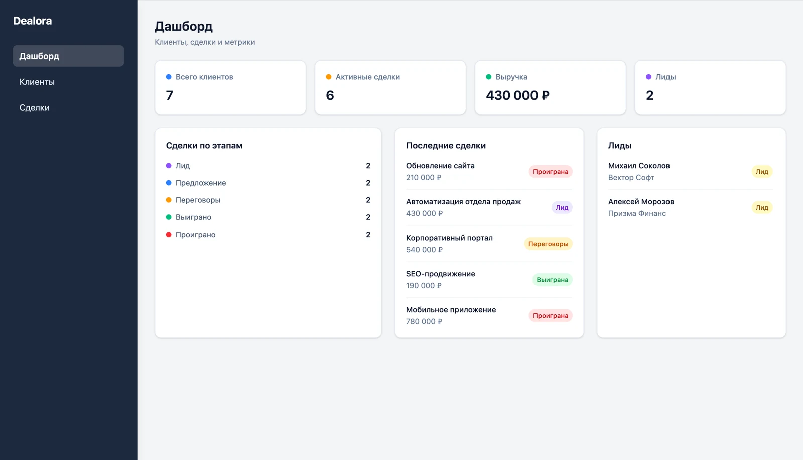
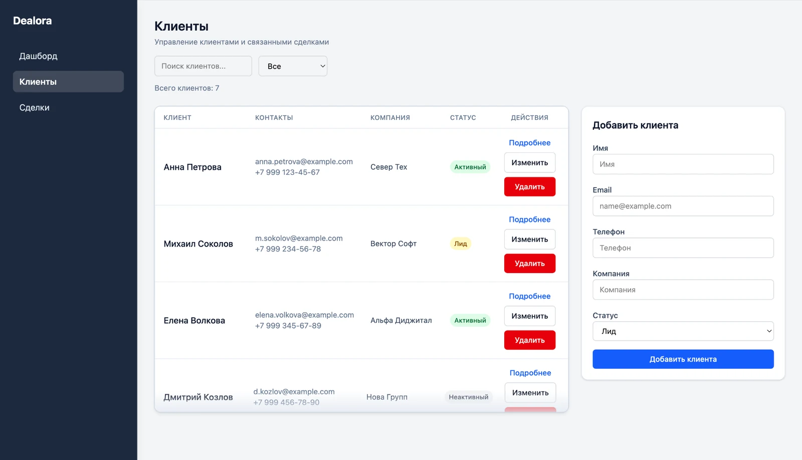
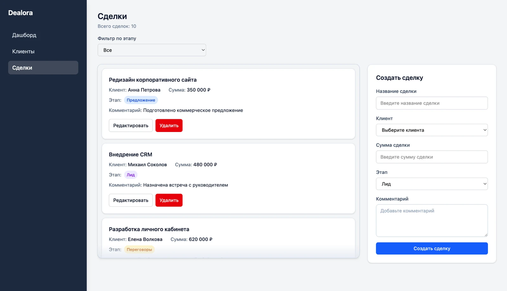
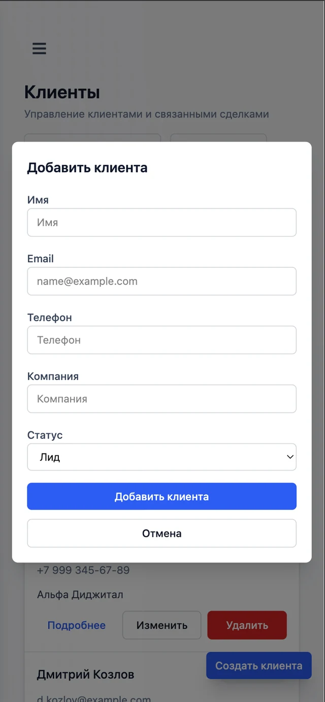

# Dealora

Dealora — учебная CRM для управления клиентами и сделками.

Приложение позволяет вести клиентскую базу, отслеживать сделки по этапам, просматривать основные показатели и работать с данными через русскоязычный адаптивный интерфейс.

## 🎯 Цель проекта

Dealora создана как учебный CRM-проект для практики React, TypeScript, Redux Toolkit, взаимодействия с API и разработки бизнес-интерфейсов.

Проект демонстрирует организацию клиентской части приложения, управление состоянием, выполнение асинхронных запросов и работу с простым серверным API.

## 🚀 Возможности

- дашборд с количеством клиентов, активных сделок, лидов и суммой выигранных сделок;
- статистика сделок по этапам;
- отображение последних сделок;
- просмотр списка клиентов;
- поиск клиентов по имени, электронной почте, телефону и компании;
- фильтрация клиентов по статусу;
- счётчики клиентов и сделок с учётом активных фильтров;
- создание, редактирование и удаление клиентов;
- уведомление об успешном создании клиента;
- редактирование клиента через модальное окно;
- запрет удаления клиента при наличии связанных сделок;
- страница с информацией о клиенте и его сделками;
- просмотр списка сделок;
- фильтрация сделок по этапу;
- создание, редактирование и удаление сделок;
- уведомление об успешном создании сделки;
- создание сделки через модальное окно на мобильных устройствах;
- состояния загрузки и ошибки на страницах клиентов и сделок;
- состояния отсутствия данных для списков, результатов фильтрации и связанных сделок;
- адаптивный интерфейс для компьютеров и мобильных устройств;
- мобильное боковое меню;
- русскоязычный интерфейс;
- форматирование дат для локали `ru-RU`;
- форматирование денежных сумм в рублях;
- ограничение демо-данных: до 200 клиентов и до 200 сделок;
- демонстрационные данные в `db.json`.

## 🛠️ Стек

### Клиентская часть

- React
- TypeScript
- Vite
- React Router
- Redux Toolkit
- React Redux
- Axios
- Tailwind CSS

### Серверная часть

- Node.js
- Express
- `db.json`
- файловое сохранение данных через Node.js `fs`

### Инструменты

- npm
- ESLint
- Prettier
- tsx

## 🧩 Архитектура

Клиентская часть организована как `layered frontend structure` с разделением кода по назначению:

- `app` — конфигурация приложения, маршрутизация, Redux store и основной layout;
- `pages` — страницы дашборда, клиентов, деталей клиента и сделок;
- `entities` — модели, типы, Redux slices и UI-компоненты основных сущностей;
- `features` — сценарии создания, редактирования и удаления клиентов и сделок;
- `shared` — общий API-слой и переиспользуемые UI-компоненты.

Серверная часть расположена отдельно в каталоге `server` и предоставляет HTTP API на Express.

Основной поток данных:

```text
React
  → Redux Toolkit async thunks
  → API-слой
  → Axios
  → Express
  → db.json
  → ответ
  → Redux store
  → UI
```

Компоненты React отправляют действия в Redux store. Асинхронные операции выполняются через Redux Toolkit async thunks, которые обращаются к API-слою.

Axios отправляет запросы на Express-сервер. Сервер читает и изменяет данные клиентов и сделок, а затем сохраняет изменения в `db.json`. Полученный ответ обновляет Redux store и пользовательский интерфейс.

## 📦 Основные сущности

### Клиент

Клиент содержит:

- идентификатор;
- имя;
- электронную почту;
- телефон;
- компанию;
- статус;
- дату создания.

Доступные статусы:

- `lead` — лид;
- `active` — активный;
- `inactive` — неактивный.

### Сделка

Сделка содержит:

- идентификатор;
- название;
- идентификатор клиента;
- сумму;
- этап;
- комментарий;
- дату создания.

Связь между сделкой и клиентом хранится в поле `clientId`.

Доступные этапы:

- `lead` — лид;
- `proposal` — предложение;
- `negotiation` — переговоры;
- `won` — выиграна;
- `lost` — проиграна.

## 📁 Структура проекта

```text
src/
├── app/        # конфигурация приложения, маршруты, store и layout
├── pages/      # страницы приложения
├── entities/   # модели и представление клиентов и сделок
├── features/   # создание, редактирование и удаление сущностей
└── shared/     # API-слой и общие UI-компоненты

server/
└── server.ts   # Express API

db.json         # демонстрационные данные и файловое хранилище
```

## 🌐 Развёртывание и live demo

- Frontend на Netlify: [Открыть Dealora](https://dealora-crm.netlify.app/)
- Backend на Render: [Открыть API](https://dealora-backend.onrender.com/clients)

Клиентская часть получает адрес backend API через переменную окружения `VITE_API_URL`.

## ▶️ Запуск локально

Для запуска необходимы Node.js и npm.

Клонируйте репозиторий и установите зависимости:

```bash
git clone https://github.com/vasilyefff/dealora.git
cd dealora
npm install
cp .env.example .env
```

Клиентская и серверная части запускаются раздельно.

Запустите серверную часть в первом терминале:

```bash
npm run server
```

По умолчанию Express API будет доступен по адресу:

```text
http://localhost:3001
```

Запустите клиентскую часть во втором терминале:

```bash
npm run dev
```

По умолчанию приложение будет доступно по адресу:

```text
http://localhost:5173
```

Для работы с данными оба процесса должны быть запущены одновременно.

## ✅ Проверка проекта

Проверка ESLint:

```bash
npm run lint
```

Проверка TypeScript и сборка проекта:

```bash
npm run build
```

## 💡 Особенности реализации

- управление состоянием через Redux Toolkit;
- асинхронные запросы через async thunks;
- отдельный Axios API-слой для клиентов и сделок;
- Express API для операций с клиентами и сделками;
- файловое сохранение изменений в `db.json`;
- проверка связанных сделок перед удалением клиента;
- переиспользуемые UI-компоненты;
- компонент `ScrollablePanel` для прокручиваемых списков;
- адаптивные представления списков, форм и навигации;
- состояния загрузки и ошибки на страницах клиентов и сделок;
- состояния отсутствия данных для списков, результатов фильтрации и связанных сделок;
- локализованные названия статусов и этапов;
- форматирование дат и денежных сумм для локали `ru-RU`.

## 📸 Скриншоты

### Дашборд



### Клиенты



### Сделки



### Мобильная версия



## ✅ Статус проекта

Основная функциональность Dealora завершена: реализованы CRUD-сценарии клиентов и сделок, связь между сущностями, дашборд, фильтрация и основные состояния интерфейса.

Дальнейшие изменения являются необязательными улучшениями проекта.

## 🔮 Возможные улучшения

- аутентификация и авторизация;
- замена файлового хранилища на базу данных;
- настройка CI/CD.

## 👤 Автор

Кирилл Васильев

- GitHub: https://github.com/vasilyefff
